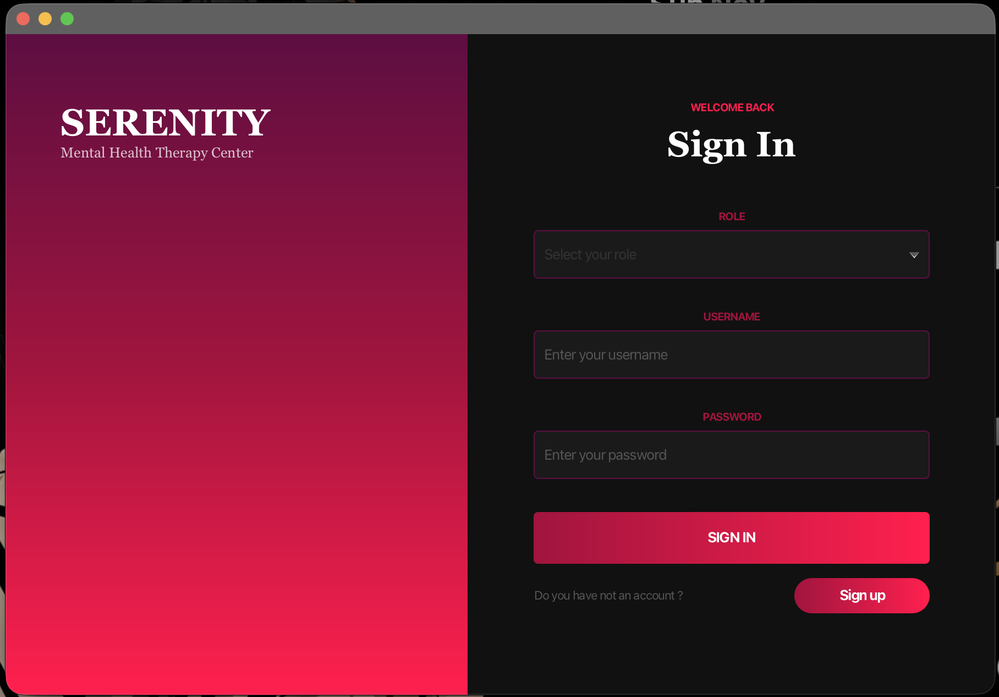
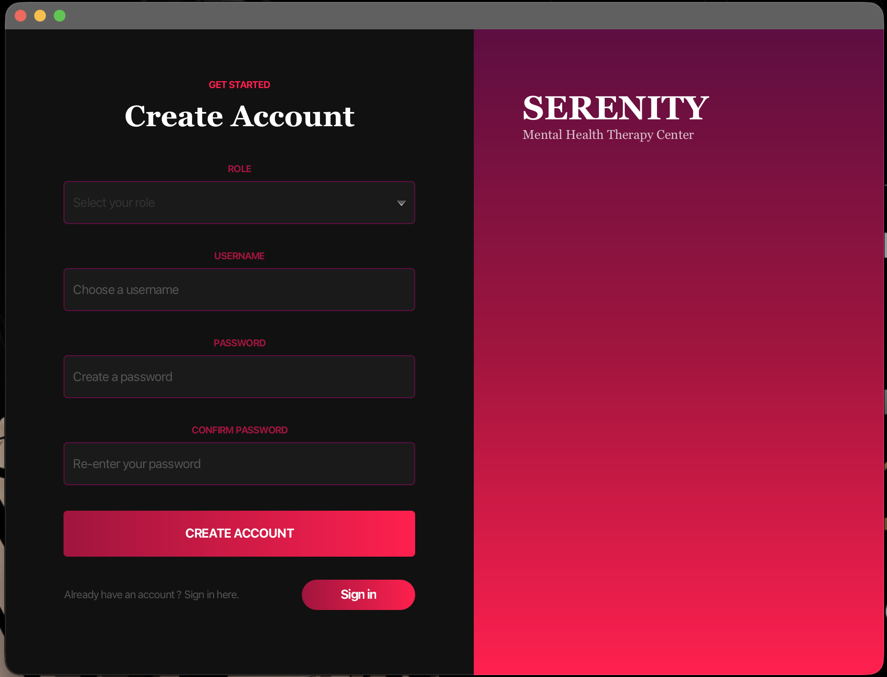
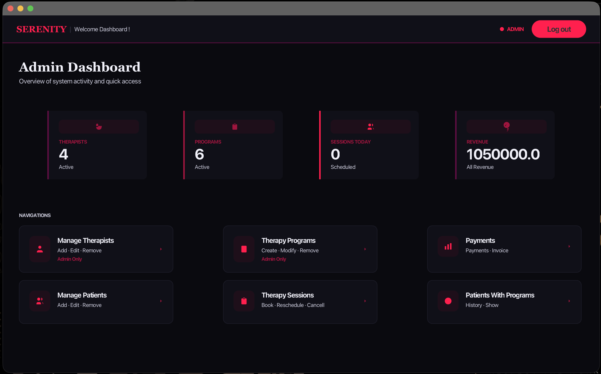
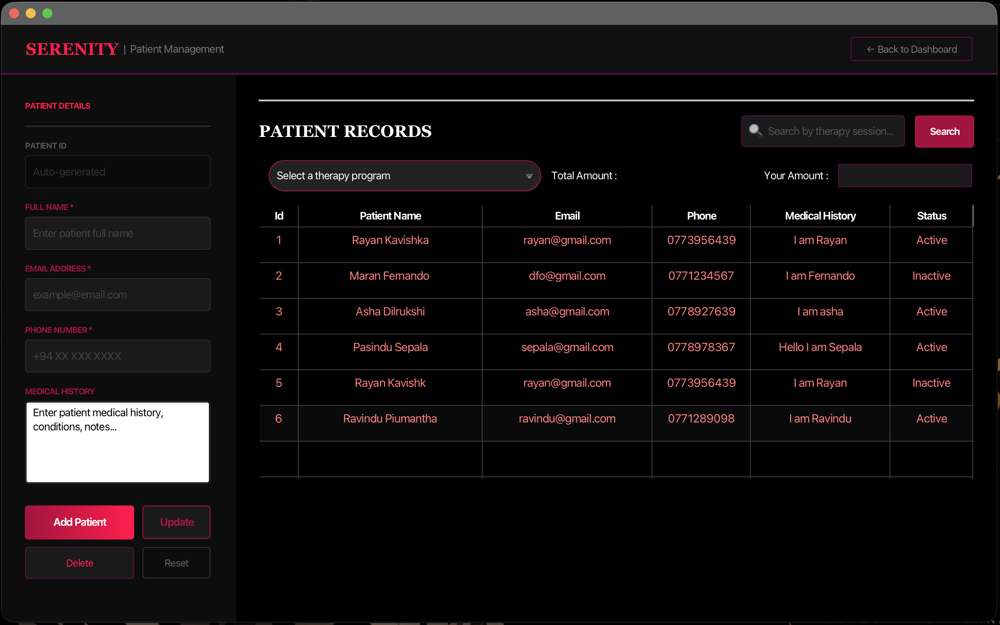
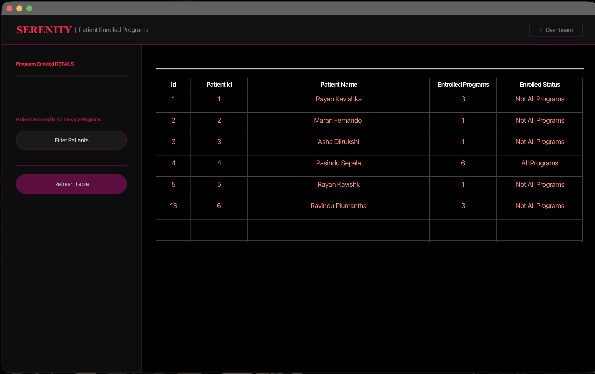
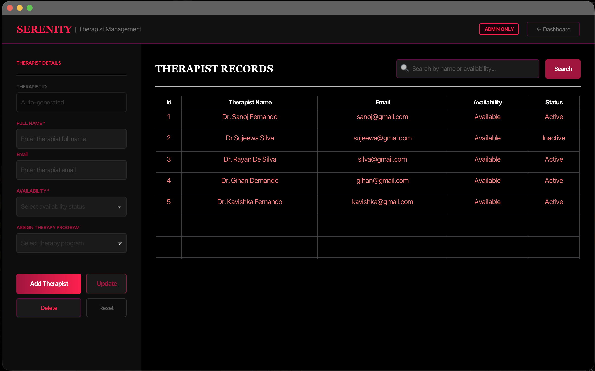
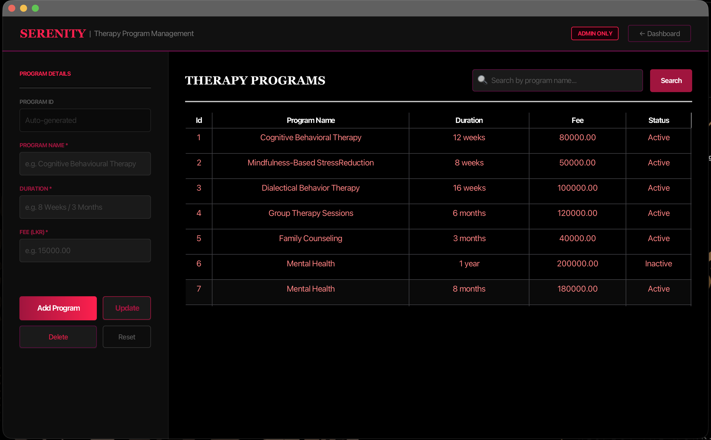
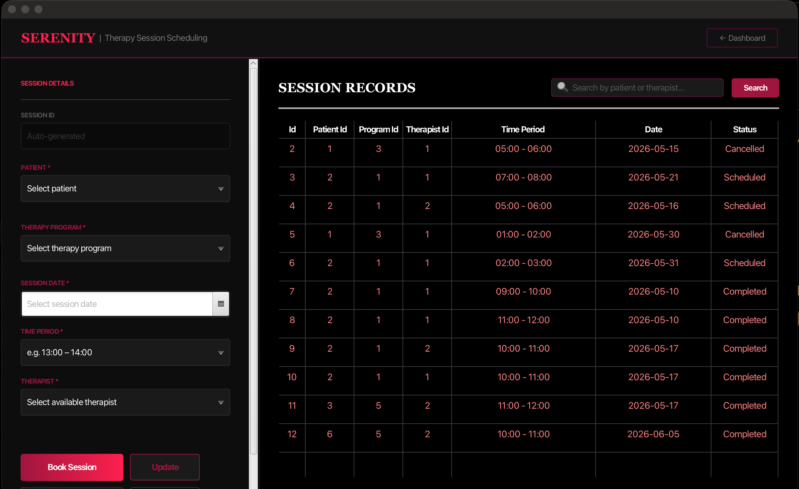
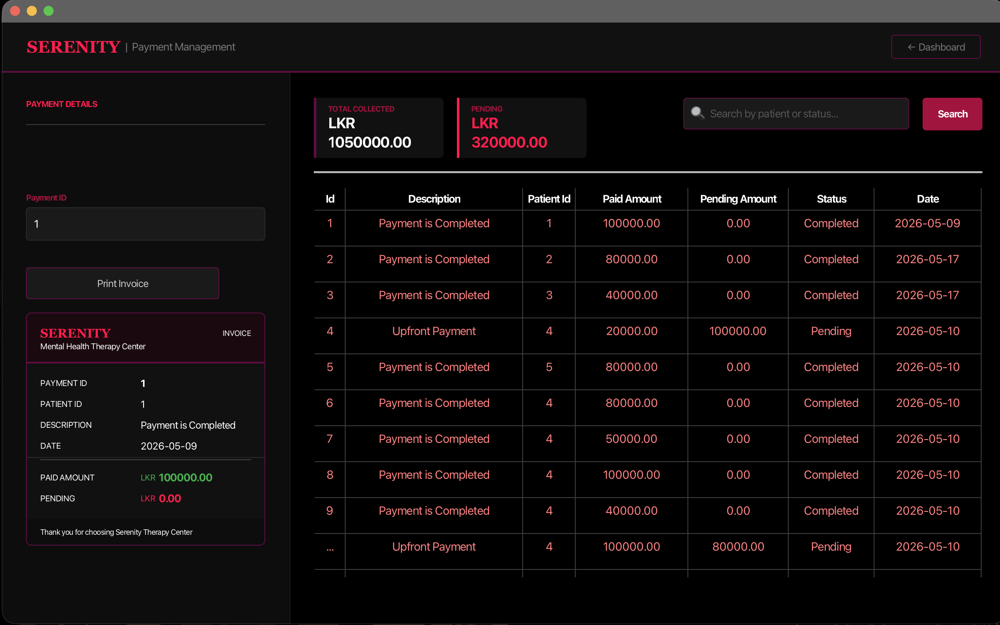
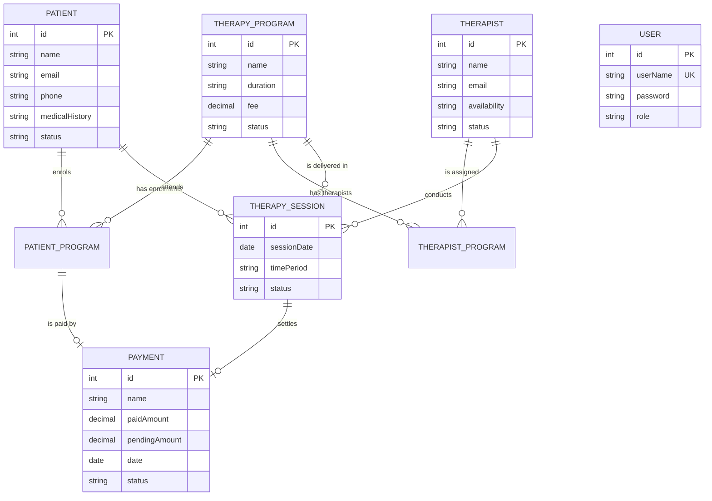

<div align="center">

# 🧠 Serenity — Mental Health Therapy Center System

**A role-based JavaFX desktop application for running a mental health therapy center: patients, therapists, therapy programs, session scheduling and payments, powered by Hibernate ORM and MySQL.**


</div>

---

## 📖 Table of Contents

- [About the Project](#-about-the-project)
- [Key Features](#-key-features)
- [Screenshots](#-screenshots)
- [Tech Stack](#-tech-stack)
- [Architecture](#-architecture)
- [Database Design](#-database-design)
- [Getting Started](#-getting-started)
- [User Roles](#-user-roles--permissions)
- [Validation Rules](#-validation-rules)
- [Project Structure](#-project-structure)
- [Author](#-author)

---

## 📌 About the Project

**Serenity** is a desktop management system for a mental health therapy center. Reception staff and administrators can register patients into therapy programs, assign therapists to programs, schedule and cancel sessions, and track payments and revenue, all from one JavaFX application.

The project was built as **ORM – Hibernate coursework** and demonstrates a clean layered architecture (Controller → BO → DAO → Hibernate), entity relationships, transactions, Hibernate second-level caching with EhCache, and secure BCrypt password storage.

---

## ✨ Key Features

| Module | What it does |
|---|---|
| 🔐 **Authentication** | Sign up / sign in with **Admin** or **Receptionist** roles. Passwords are hashed with **BCrypt (cost 12)**. |
| 📊 **Dashboard** | Live cards for **total revenue**, **today's sessions**, **therapist count** and **therapy program count**, refreshed automatically every minute. |
| 🧑‍🤝‍🧑 **Patient Management** | Register patients together with a therapy program and initial payment, update or delete records, and search the patient table. |
| 🗂 **Patients With Programs** | See which therapy programs each patient is enrolled in, with an *All Programs / Not All Programs* status, filtering and refresh. |
| 🧑‍⚕️ **Therapist Management** *(Admin only)* | Add, update and delete therapists, set availability and assign them to therapy programs. |
| 📋 **Therapy Program Management** *(Admin only)* | Create and maintain programs with name, duration, fee (LKR) and status. |
| 📅 **Therapy Sessions** | Book, update and cancel sessions. Therapists are filtered by the selected date and time period so only **available therapists** can be chosen. |
| 💳 **Payments** | Track paid and pending amounts, search by patient or status, view total collected and print an **invoice**. |
| ⚡ **Performance** | Hibernate **second-level and query cache** (EhCache via JCache) with a separate cache region per entity. |
| 🛡 **Robust error handling** | Custom exceptions (`MissingFieldsException`, `InvalidUserException`, `PaymentProcessException`) and transactional operations with rollback. |

---

## 📸 Screenshots

> Screenshots are stored in [`docs/screenshots/`](docs/screenshots).

### 🔑 Sign In & Sign Up
| Sign In | Sign Up |
|:---:|:---:|
|  |  |

### 📊 Dashboard


### 🧑‍🤝‍🧑 Patient Management


### 🗂 Patients With Programs


### 🧑‍⚕️ Therapist Management


### 📋 Therapy Program Management


### 📅 Therapy Session Scheduling


### 💳 Payment Management & Invoice


---

## 🛠 Tech Stack

| Layer | Technology |
|---|---|
| Language | Java 21 (JPMS modular project) |
| UI | JavaFX 21.0.6 (FXML + CSS), ControlsFX 11.2.1 |
| ORM | Hibernate ORM 6.6.4.Final (Jakarta Persistence) |
| Caching | Hibernate JCache + EhCache 3.10.8 |
| Database | MySQL (Connector/J 9.0.0) |
| Security | jBCrypt 0.4 |
| Utilities | Lombok 1.18.36 |
| Testing | JUnit Jupiter 5.12.1 |
| Build | Maven + Maven Wrapper, JavaFX Maven Plugin 0.0.8 |

---

## 🏗 Architecture

The application uses a strict layered design with **Factory** and **Singleton** patterns tying the layers together.

```
┌─────────────────────────────────────────────┐
│  View (FXML + CSS)  ←→  Controllers          │  Presentation
├─────────────────────────────────────────────┤
│  BO layer  (BOFactory → *BOImpl)             │  Business logic, transactions
├─────────────────────────────────────────────┤
│  DAO layer (DAOFactory → *DAOImpl, CrudDAO)  │  Data access
├─────────────────────────────────────────────┤
│  Hibernate ORM (FactoryConfiguration)        │  Mapping + L2 cache (EhCache)
├─────────────────────────────────────────────┤
│  MySQL                                       │  Persistence
└─────────────────────────────────────────────┘
        DTOs and TMs carry data between layers
```

**Design patterns used:** Factory (`BOFactory`, `DAOFactory`), Singleton (`FactoryConfiguration`), DAO, Business Object, DTO / Entity / Table Model separation.

---

## 🗃 Database Design

The schema is generated automatically by Hibernate (`hbm2ddl.auto=update`).



---

## 🚀 Getting Started

### Prerequisites

- **JDK 21**
- **MySQL Server** running on `localhost:3306`
- **Maven 3.9+** (or the included Maven Wrapper)
- IntelliJ IDEA (recommended)

### 1. Clone the repository

```bash
git clone https://github.com/RayanKavishka/Mental_Health_Therapy_Center_System.git
cd Mental_Health_Therapy_Center_System
```

### 2. Configure the database

Open `src/main/resources/hibernate.properties` and set your own MySQL credentials:

```properties
jakarta.persistence.jdbc.url=jdbc:mysql://localhost:3306/mentalHealthTherapyCenter?createDatabaseIfNotExist=true
jakarta.persistence.jdbc.user=root
jakarta.persistence.jdbc.password=YOUR_PASSWORD
```

The `mentalHealthTherapyCenter` database and all tables are **created automatically** on first launch.

### 3. Run the application

```bash
# Linux / macOS
./mvnw clean javafx:run

# Windows
mvnw.cmd clean javafx:run
```

Or run `lk.ijse.mental_health_therapy_center_system.Application` from your IDE.

### 4. First login

1. On the sign-in screen click **Sign up** and create an account (choose **Admin** to access every module).
2. Return to **Sign in**, select the same role and log in.

---

## 👥 User Roles & Permissions

| Feature | Admin | Receptionist |
|---|:---:|:---:|
| Dashboard | ✅ | ✅ |
| Patient Management | ✅ | ✅ |
| Patients With Programs | ✅ | ✅ |
| Therapy Sessions | ✅ | ✅ |
| Payments & Invoices | ✅ | ✅ |
| Therapist Management | ✅ | ❌ |
| Therapy Program Management | ✅ | ❌ |

---

## ✅ Validation Rules

| Field | Rule |
|---|---|
| Username | 4–15 characters: letters, numbers or underscore |
| Password | At least 5 characters |
| Patient / therapist name | Must start with a capital letter |
| Email | Standard `name@domain` format |
| Patient phone | Sri Lankan mobile format, e.g. `07XXXXXXXX` |
| Required fields | Medical history, therapy program and payment amount are mandatory when registering a patient |

---

## 📂 Project Structure

```
src/main
├── java/lk/ijse/mental_health_therapy_center_system
│   ├── Application.java        # JavaFX entry point
│   ├── bo/                     # BOFactory, BO interfaces, custom/impl
│   ├── dao/                    # DAOFactory, CrudDAO, custom/impl
│   ├── config/                 # FactoryConfiguration (Hibernate SessionFactory)
│   ├── controller/             # JavaFX controllers
│   ├── dto/                    # Data transfer objects
│   ├── entity/                 # Hibernate entities
│   ├── exception/              # Custom exceptions
│   ├── tm/                     # Table models
│   └── util/                   # AlertMode, NavigationUtil
├── java/module-info.java
└── resources
    ├── hibernate.properties
    ├── ehcache.xml             # Cache regions (10 min TTL, 500 entries)
    └── lk/ijse/.../view        # FXML views + styles (table.css, comboBox.css)
```

---

## 👤 Author

**Rayan Kavishka**
GitHub: [@RayanKavishka](https://github.com/RayanKavishka)

---

<div align="center">

⭐ If you like this project, give it a star!

</div>
